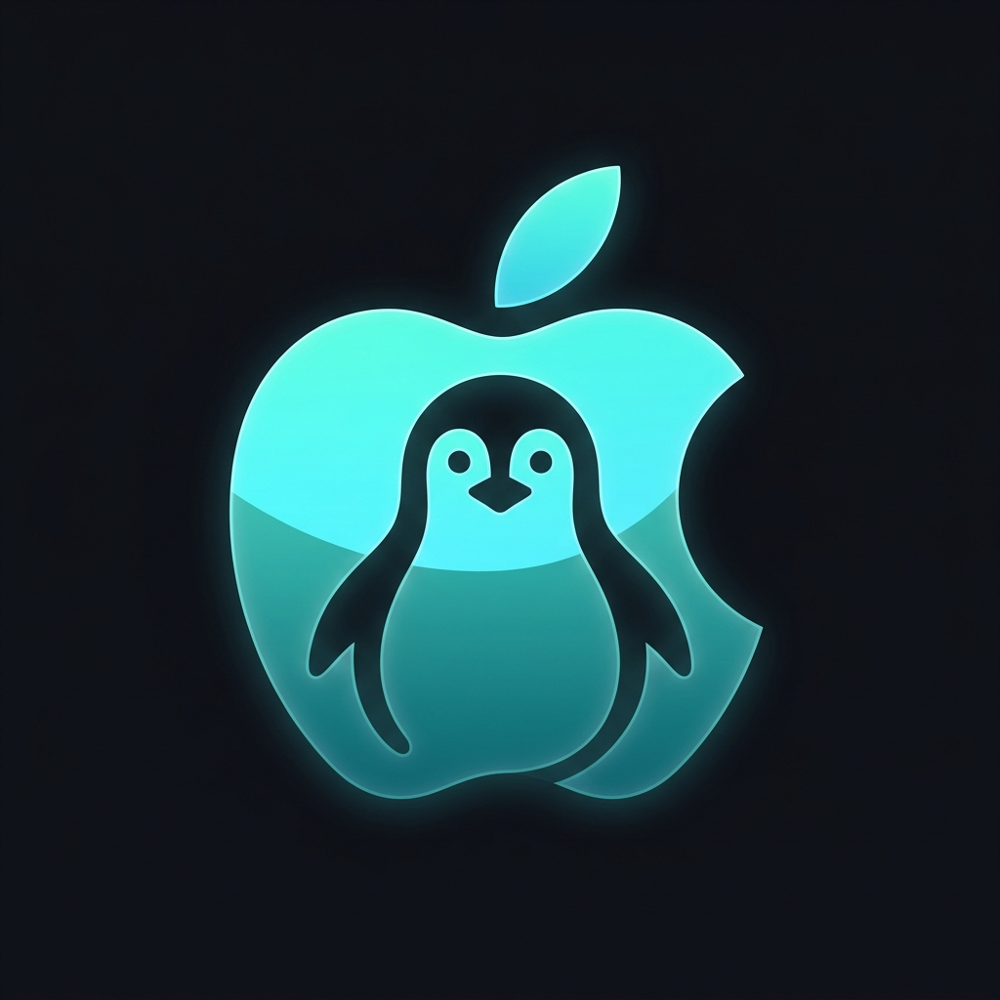

<p align="center">
  
</p>

<h1 align="center">MacNix 2.0</h1>

<p align="center">
  <b>macOS'u Linux üzerinde bir sanal makinede çalıştıran, tek USB'lik kurulum sistemi.</b>
</p>

<p align="center">
  <a href="#kurulum"></a>
  <a href="#gpu-gerçeği"></a>
  <a href="../../actions"></a>
</p>

---

## MacNix nedir?

MacNix, bilgisayarınızı **macOS için bir hipervizöre** dönüştüren minimal bir
Debian tabanlı sistemdir. USB'den açılır, Calamares ile diske kurulur, açılışta
sizi doğrudan **MacNix Kurulum Sihirbazı** karşılar: macOS kurtarma imajını
indirir, OpenCore yapılandırmasını üretir, QEMU/KVM sanal makinesini hazırlar.

**Ne değildir:**

- ❌ Hackintosh değildir — macOS **gerçek donanımda** değil, sanal makinede çalışır
- ❌ Dual-boot değildir — GRUB menüsünde Windows/macOS seçimi yoktur
- ❌ "Her GPU'da tam hız" değildir — aşağıdaki GPU bölümünü okuyun

---

## Ne test edildi, ne edilmedi

Bu bölüm kasıtlı olarak en üstte. MacNix 2.0'ın hangi kısmının gerçekten
**ölçüldüğünü** hangisinin **henüz denenmediğini** ayırıyoruz.

### ✅ Gerçekten test edildi (QEMU, canlı önyükleme + gerçek kurulum)

| Test | Sonuç |
|---|---|
| ISO'nun önyüklenmesi (BIOS + UEFI) | ✅ çekirdek → canlı masaüstü |
| Otomatik giriş → openbox → Calamares açılışı | ✅ "Welcome to the MacNix 2.0 installer" |
| Kurulumun diske uygulanması (30 GB, `/dev/vda`) | ✅ 57 626 dosya, fstab, machine-id, kullanıcı |
| GRUB **UEFI** kurulumu | ✅ `grub-install --target=x86_64-efi` → 0 |
| GRUB **BIOS** kurulumu | ✅ `grub-install --target=i386-pc` → 0 |
| UEFI yedek önyükleyici (`\EFI\BOOT\BOOTX64.EFI`) | ✅ boş NVRAM'de bile sistem açılıyor |
| Kurulu sistemin BIOS'tan açılışı | ✅ GRUB → MacNix sihirbazı |
| Kurulu sistemin UEFI'den açılışı | ✅ GRUB → MacNix sihirbazı |
| Statik doğrulama + modül testleri | ✅ 49 denetim / 93 birim testi, 0 hata |

### ❌ Henüz test EDİLMEDİ (dürüstçe)

| Test | Neden |
|---|---|
| **macOS'un kurulup açılması** | Test ortamında KVM yok (TCG), macOS kurulumu saatler sürer; Apple imajı ~700 MB indirme gerektirir |
| **VFIO GPU passthrough** | Test ortamında geçirilecek gerçek GPU yok |
| **Gerçek donanımda kurulum** | Kullanıcı testi bekliyor |
| Calamares sihirbazının grafik arayüzüyle sonuna kadar tıklanması | Başsız test ortamında pencere yöneticisi odağı yok; exec aşamasının tamamı ayrıca doğrulandı |

Yani: **kurulum yolu kanıtlanmış, macOS'un kendisi henüz kanıtlanmamış.**

---

## GPU gerçeği

macOS'un kendi grafik sürücüsü **yalnızca belirli AMD kartlar** için vardır.
MacNix bunu saklamaz; kurulum ekranında ve `macnix-doctor` çıktısında açıkça
yazar.

| Donanım | macOS'ta hızlandırma | MacNix ne yapar |
|---|---|---|
| RX 580 / 570 / 590 (Polaris) | ✅ tam | VFIO passthrough |
| RX 5500–5700 XT (Navi 10) | ✅ tam | VFIO passthrough |
| RX 6600–6950 XT (Navi 21/22) | ✅ tam | VFIO passthrough |
| Vega 56/64, Radeon VII | ✅ tam | VFIO passthrough |
| **NVIDIA (tümü)** | ❌ sürücü yok | yazılım render |
| **Intel iGPU (yeni nesil)** | ❌ sürücü yok | yazılım render |
| **Eski AMD (TeraScale, GCN1-2)** | ❌ sürücü yok | yazılım render |
| RDNA3 (RX 7000) | ❌ | yazılım render |
| GPU yok (sunucu) | — | başsız + VNC |

**Cihaz kimliği taklidi (spoof) çözüm değildir:** Apple'ın kextleri kapalı
kaynaktır ve kartın firmware'ini okur. R7 M340'ı RX 580 gibi göstermek sürücüyü
yükler ama **siyah ekran** verir. VirGL/VMware SVGA3D/Apple PVGPU yolları da
bu donanımda Metal sağlamaz.

**Yazılım render modunda ne olur:** macOS açılır, masaüstü/Safari/ofis akıcıdır;
oyun, Final Cut timeline ve video kodlama yoktur.

---

## Kurulum

### 1) ISO'yu indir

[Releases](../../releases) sayfasından `macnix-2.0.0-amd64.iso` ve `.sha256`
dosyasını alın.

```bash
sha256sum -c macnix-2.0.0-amd64.iso.sha256
```

### 2) USB'ye yaz (DD modu — Rufus'ta "DD Image" seçin)

```bash
sudo dd if=macnix-2.0.0-amd64.iso of=/dev/sdX bs=4M status=progress oflag=sync
```

> Ventoy'un "ISO modu" canlı medyayı bulamaz; DD modu kullanın.

### 3) USB'den aç, sihirbazı izle

GRUB menüsü → **MacNix 2.0 — Kurulumu Başlat**. Canlı masaüstü açılır ve
Calamares kendiliğinden başlar (giriş ekranı görürseniz: `macnix` / `macnix`).

Kurulum adımları: dil → **donanım raporu** → bölge/klavye → disk → kullanıcı →
kur. Donanım raporu ekranı bu makinede macOS'un nasıl çalışacağını
(passthrough / yazılım render) söyler; **hiçbir uyarı kurulumu engellemez.**

### 4) İlk açılış

`macnix-setup` sihirbazı açılır: macOS kurtarma imajı indirilir, OpenCore
yapılandırılır, VM diski hazırlanır. Sonra:

```bash
sudo macnix-vm start
```

### Gereksinimler

| | En az | Önerilen |
|---|---|---|
| CPU | 4 çekirdek, x86-64, VT-x/AMD-V **BIOS'ta açık** | 6+ |
| RAM | 4 GB | 16 GB |
| Disk | 25 GB | 80 GB SSD |
| GPU | herhangi biri (hiç olmasa da olur) | macOS sürücüsü olan AMD kart |

---

## Komutlar

```bash
macnix-doctor          # tanılama; 0 = sorun yok, 1 = uyarı, 2 = kritik
macnix-setup           # macOS kurulum sihirbazı (GUI)
macnix-setup --download  # yalnızca macOS imajını indir
sudo macnix-vm start   # macOS sanal makinesini başlat
sudo macnix-gpu-mode   # VFIO / yazılım render modu
macnix-log --tar       # günlük paketi
sudo macnix-tui        # metin modunda kurulum (X açılmazsa)
```

---

## Nasıl derlenir

```bash
sudo apt-get install -y debootstrap squashfs-tools xorriso \
  grub-efi-amd64-bin grub-pc-bin mtools dosfstools isolinux syslinux-utils

sudo WORK=/tmp/build OUT=$PWD/out ./build.sh          # tam derleme (~15 dk)
bash tools/validate.sh                                 # statik denetim
python3 tools/test-modules.py                          # Calamares modül testleri
```

GitHub Actions her push'ta derler ve `latest` Release'ine ekler
(`.github/workflows/build-iso.yml`).

---

## Mimari

```
ISO (hibrit: BIOS + UEFI)
└── canlı sistem (Debian bookworm + squashfs)
    ├── macnix-live.service → medya keşfi, izin onarımı, otomatik giriş
    ├── openbox + Calamares (gözcülü) → kurulum sihirbazı
    └── Calamares exec:
        partition → mount → shellprocess (medya) → unpackfs → machineid
        → fstab → locale → keyboard → users → displaymanager → networkcfg
        → hwclock → macnix-gpu-detect → macnix-gpu-config → bootloader
        → macnix-efi-fallback → umount

kurulu sistem
├── /etc/macnix/{install-plan.json,vm.conf,smbios.json,vfio.conf}
├── macnix-firstboot.service → macnix-setup (macOS imajı + OpenCore + VM disk)
└── macnix-vm.service → QEMU/KVM (VFIO veya virtio-gpu)
```

---

## Lisans ve yasal not

macOS, Apple Inc.'in telif hakkıyla korunan yazılımıdır. Apple'ın yazılım
lisansı macOS'un **yalnızca Apple markalı donanımda** çalıştırılmasına izin
verir. MacNix yalnızca bir sanallaştırma/otomasyon aracıdır; macOS imajını
dağıtmaz, indirmez veya lisanslamaz. Kullanım sorumluluğu kullanıcıya aittir.

Kod: MIT (bkz. `LICENSE`).
